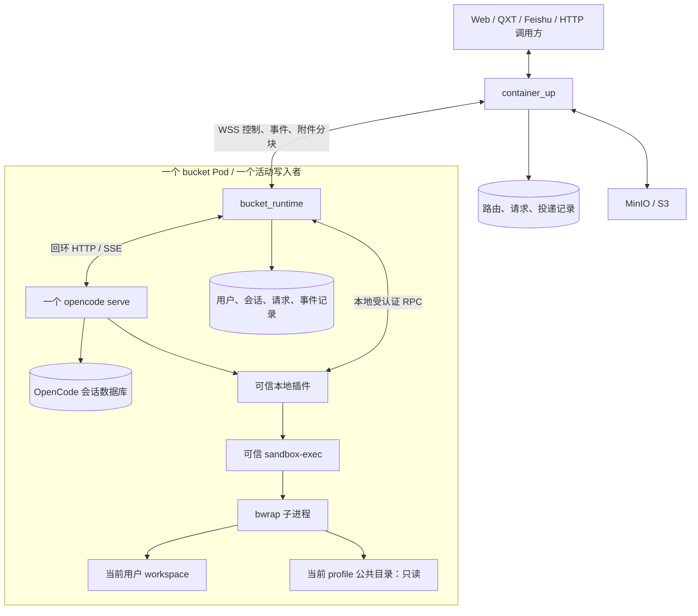
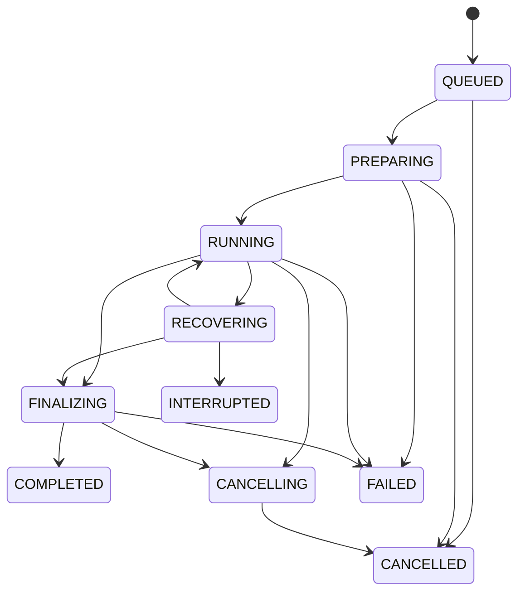
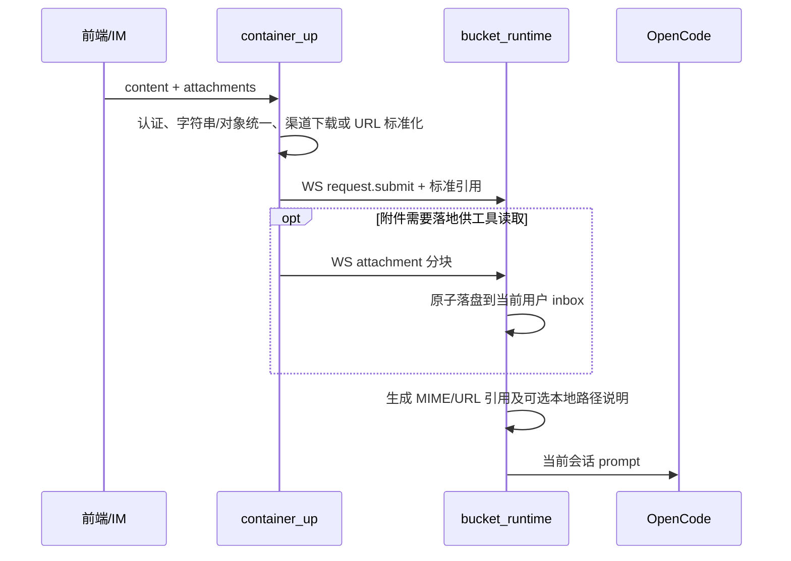

# OpenCode 后端迁移与 bucket runtime 重构方案

日期：2026-09-18

状态：方案已在 `codex/opencode-backend` 分支落地核心链路；版本实测、实施取舍、部署与验收范围见 [实现说明](OPENCODE_BACKEND_IMPLEMENTATION.md)。

现有业务基线：`ae37e6c1`（当前分支合并前 HEAD）。当前工作区与上游的合并冲突不属于本方案的实现结果。

## 1. 目标与关键决策

用固定版本的官方 OpenCode 二进制替换 nanobot agent 后端。每个 bucket 只运行一个 `opencode serve`，由 bucket runtime 管理进程、会话、执行状态和权限。container_up 保留业务接入、bucket 调度、对象存储及渠道投递。

| 项目 | 决策 |
|---|---|
| container_up ↔ bucket runtime | bucket 主动连接 container_up，使用持久双向 WebSocket；业务控制、结果、附件传输均走该连接 |
| bucket runtime ↔ OpenCode | 回环 HTTP 发命令，SSE 接收事件；不要求 OpenCode 支持自定义 WS 协议 |
| OpenCode 实例数 | 每 bucket 一个，无每用户端口或 gateway 子进程 |
| 用户工作目录 | 每 `(frontend_id, user_id)` 独立目录，跨该用户的多个对话复用 |
| 会话 | 每 `(frontend_id, user_id, chat_id, generation)` 映射一个根 OpenCode session |
| 原生文件工具 | session 权限 + before hook 校验；未证明安全覆盖的工具默认关闭 |
| shell | before hook 包装命令，可信执行器通过 bwrap 执行；执行器失败不得回退宿主 |
| 公共目录 | 按 profile 指定的技能、模板、参考资料，只读；公共不代表所有前端配置均可见 |
| 附件输入 | 保留 URL 标准化、文件上传、渠道下载适配和 MIME 引用语义 |
| 附件输出 | 通过明确的 `publish_attachment` 工具上传并登记，runtime 汇总后交付 |
| 回复完成 | 由 runtime 状态机判定；工具结果、文本增量、单独 idle 事件均不能直接作为最终回复 |
| 离线部署 | 二进制、插件、Python 包、浏览器、模型配置均预置，运行时不安装公网依赖 |
| 源码依赖 | 新服务不导入 `nanobot.*`；不维护 OpenCode 核心分叉作为默认路径 |
| 首版持久化 | container_up 单活 SQLite；每 bucket 独立 SQLite 与 OpenCode 数据目录。多副本另行扩展 |

本方案覆盖业务消息、附件、报告生成、回复、取消、重启恢复和隔离策略。nanobot 的 Dream 记忆、cron/heartbeat、原生 WebUI、OpenAI-compatible API 不是天然兼容项，见迁移范围表；不能随删除 nanobot 一并静默下线。

## 2. 现有实现及需要解决的问题

以下路径按基线 HEAD 阅读，当前工作区中的同名文件可能含 merge 标记。

| 现有位置 | 当前职责 | 新实现 |
|---|---|---|
| `container_up/app.py` | HTTP/IM 入站、同步等待、附件接口、出站入口 | 保留外部契约；向内部 WS 路由；拆出请求与交付状态 |
| `container_up/bucket_scheduler.py` | 为用户分配进程实例所在 bucket | 按用户粘性绑定 bucket，根据活跃任务与容量调度 |
| `container_up/bucket_client.py` | HTTP 创建实例、消息、取消 | 替换为 WS 命令投递与 ACK 跟踪 |
| `container_up/bucket_manager.py` | bucket K8s 生命周期 | 保留，去掉每用户进程配置和源码卷依赖 |
| `container_up/sync_reply.py` | 内存 Future；拦截第一条匹配出站包 | 等待持久化的 request terminal 结果，支持重连后查询 |
| `container_up/outbound_attachment_store.py` | MinIO/S3 上传与 URL | 保留、增加 upload_id 幂等与不可变对象 key |
| `container_up/qxt_im_tool.py` 等 | 平台解析、下载、媒体上传与发送 | 保留，统一消费业务结果与附件对象 |
| `bucket_runtime/process_manager.py` | 每用户启动 local_service，分配端口 | 一个 OpenCode supervisor + 用户/会话仓库 + 请求调度 |
| `bucket_runtime/local_service.py` | gateway 与 runtime 的 WS 中继 | 新后端删除 |
| `bucket_runtime/port_allocator.py` | 每用户分配端口 | 删除 |
| `nanobot/channels/bridge.py` | 协议转化与双向中继 | 由 runtime 的 WS 协议层和事件投影替代 |
| `nanobot/utils/document.py` | 调 container_up，附件转 MIME/URL 引用 | 迁出附件标准化逻辑；不搬整个文件解析模块 |
| `nanobot/agent/tools/message.py` | bridge 附件上传、继承 metadata、立即发送 | `publish_attachment` + runtime 结果聚合 |

必须纠正的已有行为：

1. HEAD 的图片/视频 `visual_refs.append(...)` 已注释，实际主要是文本 URL 引用；迁移不要误称已保留原生视觉输入。
2. HTTP attachments 可包含对象，但 bridge 入站逐项 `str(item)`；新协议统一结构，禁止字典字符串化。
3. 当前同名 MinIO 对象 key 可能覆盖旧附件；新上传生成稳定且唯一的 artifact/upload ID。
4. 当前同步接口可能收到第一次 message 工具发送就完成；新方案以完整请求终态结束。
5. 当前 metadata 同时承担路由、业务数据和内部状态；新协议将可信身份与非可信业务 metadata 分开。
6. 当前多份环境变量、frontend 配置和 host/child 路径转换重复，且有静默默认值；新配置只在进程入口加载和校验。

## 3. 架构与责任边界



### 3.1 container_up

- 验证外部身份，确定 frontend、user、chat 与允许的 profile；不信任请求体中自行声明的权限或路径。
- 管理 user → bucket 绑定、bucket 启停与单活连接租约。
- 规范化前端附件，持有 MinIO 与 IM 凭据，执行 QXT/Feishu/Web 投递。
- 保存业务请求、最终结果、投递幂等状态，支持同步 HTTP 和异步回调。
- 不解析 OpenCode 原始 Part/Message，不参与模型循环，不为每个用户创建进程。

### 3.2 bucket runtime

- 监督唯一 OpenCode 子进程，负责 readiness、SSE 订阅、重启及恢复。
- 维护所有 session 所有权与 request 映射；生成并安装每 session 的权限策略。
- 串行化同一用户的任务，限制 bucket 总并发；后续有必要再开放同用户多会话并发。
- 接收 OpenCode 事件并投影为业务事件，查询最终消息快照，处理错误和取消。
- 向插件提供可信执行上下文与附件发布服务，不将业务凭据注入模型上下文。
- 将业务结果、附件和资源状态通过 WS 发给 container_up。

### 3.3 OpenCode 与可信插件

- OpenCode 负责 LLM 请求、上下文管理、工具调度和自身会话持久化。
- 插件只做 session 身份绑定校验、工具策略、bash 包装、产物工具及必要的业务提示注入。
- 插件不能自行决定用户归属，不能从模型传入的 user_id、环境全局变量或“最近一次请求”推断身份。
- 业务前端无法直连 OpenCode，也不提供通用 API 透传。只允许 runtime 调用明确的内部接口。

## 4. 部署、目录和用户标识

bucket runtime 使用 supervisor 启动固定路径的 OpenCode，启动工作目录为受信任的空目录；示意为 `opencode serve --hostname 127.0.0.1 --port 4096`。确切命令、配置字段与 API 版本由阶段 0 固定。

```text
/opt/app/                          服务代码、插件、sandbox-exec，只读
/opt/toolchain/                    Python、浏览器、字体、系统工具，只读
/opt/runtime-context/              OpenCode 启动目录，不含用户文件
/opt/public/common/                全局公共技能/模板，只读
/opt/public/profiles/<profile>/    前端或业务 profile 公共资料，只读
/data/workspaces/<user_key>/       用户文件，可读写
    inbox/                        输入附件
    output/                       待交付产物
    scratch/                      用户任务临时文件
/data/runtime/                    runtime.db、待上传的不可变快照、outbox
/data/opencode/                   OpenCode DB、状态、缓存，不对工具开放
/run/secrets/                     服务端凭据，不对工具开放
/run/runtime/                     本地 RPC 凭据/执行票据，不对沙箱挂载
```

- `user_key` 由数据库分配 UUID，唯一约束为 `(frontend_id, user_id)`，不要只替换非法字符生成路径，避免碰撞。
- `conversation_key` 使用数据库 ID；逻辑唯一键包含 frontend、user、chat、generation。重开会话只递增 generation，不清空 workspace。
- 公共目录中的技能不能包含服务密钥；用户私有资料不能放入全局技能目录。
- OpenCode、插件、bwrap 使用一致的工作目录与公共目录绝对路径，避免模型读到的 skill base path 与执行路径不一致。
- 不再挂载 SOURCE_PVC，不从 PVC 上运行 Python 源码；代码和工具链随镜像发布。工作区及状态才持久化。
- 一个 bucket 的 OpenCode DB 与 runtime.db 只能由该 bucket 单写；禁止多个实例共享同一 SQLite 文件。
- 首版 user 粘性绑定 bucket。缩容保留卷和 bucket 身份，唤醒同一 bucket；不自动将历史用户迁到另一 OpenCode DB。
- 跨 bucket 迁移作为显式 drain/export/import 操作实施，先验证选定版本的会话迁移能力；未验证前不可只移动映射记录。

## 5. container_up ↔ bucket runtime 双向 WS 协议

### 5.1 连接与认证

1. bucket 启动后连接 container_up 的 `/internal/buckets/ws`，发送 hello：bucket_id、进程 boot_id、协议版本、OpenCode 版本、策略版本、恢复游标和容量。
2. 使用内网 TLS 与挂载的服务凭据认证。container_up 将凭据绑定 bucket 身份，不接受仅靠 hello 自报身份。
3. container_up 为活动连接分配 `connection_epoch`。同 bucket 新连接生效后旧连接失效，消息必须校验 epoch。
4. user 绑定带 `assignment_epoch`，重新分配时递增；旧 bucket 的迟到事件不能覆盖新归属。
5. 连接每 20 秒心跳，60 秒无响应视为失联；这些是初始默认值，集中配置，不散落在实现中。
6. 每侧一个接收循环负责解码和分发，不能在接收循环内等待上传/工具执行，否则同连接 RPC 会死锁。

### 5.2 JSON 信封（自有协议 v1，不是 OpenCode API）

```json
{
  "protocol": "agent-bucket/1",
  "type": "request.submit",
  "event_id": "evt_uuid",
  "bucket_id": "bucket-0",
  "connection_epoch": 7,
  "assignment_epoch": 3,
  "seq": 108,
  "correlation_id": "cmd_uuid",
  "request_id": "req_uuid",
  "conversation_id": "conv_uuid",
  "identity": {"frontend_id": "qxt-main", "user_id": "u123"},
  "payload": {}
}
```

`seq` 为每个方向、每个 bucket 的持久化递增序号，不随 socket 重连归零。`event_id` 去重；`correlation_id` 对应命令与应答；`request_id` 对应业务一轮请求。时间戳用于观测，不作为顺序依据。identity 由可信服务构造，OpenCode 与模型的 metadata 不能覆盖它。

### 5.3 消息类型

| 方向 | 消息 | 语义 |
|---|---|---|
| 双向 | `hello/hello.accepted`、`heartbeat`、`ack`、`error` | 连接、存活、持久化确认、协议错误 |
| CU → BR | `user.bind` | 安装用户归属、profile 与策略版本 |
| CU → BR | `request.submit`、`request.cancel`、`request.query` | 提交、取消、恢复查询 |
| CU → BR | `bucket.drain`、`profile.update` | 停止接新请求；安装已校验的新配置版本 |
| BR → CU | `request.accepted`、`request.started` | 已持久化入队／开始处理 |
| BR → CU | `response.delta`、`tool.progress` | 可合并的进度事件，不触发渠道最终投递 |
| BR → CU | `request.completed/failed/cancelled` | 带完整结果的业务终态，持久化且可重放 |
| BR → CU | `request.recovering`、`bucket.status` | 恢复过程与当前容量 |
| 双向 | `attachment.begin/chunk/commit/result/abort` | 文件传输；chunk 使用二进制信封 |
| BR → CU | `attachment.normalize` | 已有 URL 转标准附件对象，保持已有远程引用语义 |

`request.submit.payload` 包含 content、标准 attachments、受控 profile_id、deadline_at、delivery_mode（sync/callback/channel）。复杂 reply_target 留在 CU 请求记录中，BR 只需 request_id 进行回传。

### 5.4 可靠性、背压和附件传输

- 两侧持久化 inbox 去重与 outbox。ACK 表示已经持久化接受，不表示执行或外部投递成功。
- 至少一次传输 + 接收端去重；不声称跨 WS、OpenCode 和 IM 达到物理 exactly-once。
- 同 request_id、同 payload_hash 的重复提交返回现状；同 ID 不同内容拒绝。
- 正文 delta 使用 `message_id + part_id + revision` 或内容快照覆盖，避免重放后重复拼接；最终结果始终带完整正文。
- 终态、取消和 ACK 优先，附件分块次之，进度可合并。outbox 满时停止接新任务，不能丢终态。
- 附件不能塞进 JSON/base64 大包。二进制帧带 transfer_id、offset、chunk_length；建议 256 KiB 一块，采用有限在途窗口。
- 文件 ACK 与控制消息 ACK 分开；重连查询已持久化连续 offset。CU 使用有配额的临时文件或受控 multipart 上传，不把整文件读进内存。
- commit 校验大小、SHA-256 与 transfer 所有权，再持久化 artifact 记录并返回标准附件 JSON。commit 重复调用返回相同 artifact，URL 可重新签发。
- 同一 socket 存在队头阻塞，使用小块和优先队列减轻；只有压测证明需要时，才新增同协议的专用文件 WS，不先引入第二套 HTTP 数据通道。
- 对外 `/internal/attachments/upload` 可保留兼容，但新 BR 不通过该 HTTP 端点绕开 WS；两者调用同一个 CU AttachmentService。

## 6. 会话、请求与事件状态

### 6.1 数据所有权

| 存储 | 主要表/记录 | 所有权 |
|---|---|---|
| CU DB | buckets、user_bindings、requests、deliveries、artifacts、ws_inbox/outbox | 业务身份、路由、最终结果、外部投递 |
| BR DB | users、conversations、session_bindings、runs、tool_calls、artifact_intents、ws_inbox/outbox | OpenCode 关联、执行恢复、产物状态 |
| OpenCode DB | 原始会话、消息、parts、模型使用量 | OpenCode 自身，不直接 SQL 修改 |

关键字段：

- conversations：业务唯一键、root_session_id、profile_revision、policy_hash、directory、generation。
- session_bindings：session_id、root_session_id、user_key、父 session、创建状态；根与子 session 均需登记。
- runs：request_id、input_message_id、execution_state、deadline、最后消息 revision、最终结果 hash、取消原因。
- tool_calls：session_id、call_id、request_id、执行票据、开始/结束、取消状态。
- artifact_intents：request_id、call_id、artifact_id、源文件快照 hash、upload_id、上传状态、顺序。

首版每用户同时最多一个活动请求，包括其子任务；多个用户并行。排队在 runtime 中完成，不直接向忙碌 session 注入新用户输入。同一轮内部仍可能并发调用工具，因此 runtime 另设每用户的文件操作互斥，覆盖原生文件工具、bash 和附件快照；不能把请求串行等同于工具串行。

### 6.2 执行状态机



execution_state 与 delivery_state 分开：模型完成不代表 QXT/Web 已成功收到。delivery_state 可为 pending/sending/sent/failed/unknown。

`INTERRUPTED` 表示执行结果无法可靠确认，对外映射为 `request.failed`，错误码为 `EXECUTION_INTERRUPTED`，并携带可查询的 request_id；不得自动当成可安全重试的新请求。已经持久化的终态不可被迟到的取消、delta 或工具事件覆盖。

### 6.3 OpenCode 适配接口

runtime 内部仅依赖以下窄接口，实际 HTTP 路径封装在一处：

```text
health() / capabilities()
create_session(directory, profile, permissions) -> session_id
read_or_set_session_permissions(session_id, policy)
submit_prompt(session_id, message_id, parts, model, agent)
subscribe_events() -> normalized raw events
list_messages(session_id) / session_status(session_id)
abort(session_id)
```

官方当前 server 文档提供同步 message、异步 prompt 和 SSE 能力；实现选异步提交 + SSE + 查询补偿。是否允许客户端指定 message ID、能否查询提交结果、规则更新接口与事件形状必须在固定版本实测后落入 adapter 契约测试。

### 6.4 完成判定

OpenCode 事件不是业务结果，BR 的 event_projector 负责投影：

1. 仅处理 session_bindings 中已归属的会话；无法归属的事件进入内部隔离日志，不向任何用户广播。
2. 校验请求提交消息与当前 assistant 消息的关联；不能只按“这个 session 当前有请求”粗暴归属所有事件。
3. 工具结果、推理片段与中间 assistant 消息不作为最终正文。
4. 完成候选事件到达时，查询该轮消息快照；确认关联 assistant 消息结束、无未完成工具、无待关联子任务，再进入 FINALIZING。
5. FINALIZING 等待所有已成功登记的附件完成，生成唯一业务 terminal 记录与 outbox。
6. 子 session idle 只结束子任务；根 session idle 单独出现也不能完成请求。
7. 空正文但有附件可正常完成；正文与附件均为空时返回明确的 EMPTY_RESULT，不自动重跑整轮工具。

SSE 假设不可可靠历史重放。重连先订阅并缓冲，再查询未终结 run 的消息/状态，用稳定 ID 和 revision 去重合并；不能凭没收到事件判定结束。

### 6.5 取消、重启和交付

- 取消排队请求直接结束；运行中调用 OpenCode abort，并由可信执行器终止该 request 的所有沙箱进程树。只有清理完成才发送 cancelled。
- 上传中的未 commit 文件终止并回收；已上传对象保留为未投递产物按保留策略清理，取消不触发新的渠道发送。
- server 崩溃影响整个 bucket 的活动 run。暂停接单，终止孤儿命令、重启 server、核对数据库与权限；不自动重放可能有副作用的 prompt。
- 提交 HTTP 超时属于结果不确定：按预分配 message ID 查证；无法查证时标记 INTERRUPTED/恢复待处理，不能重新提交产生重复工作。
- CU 崩溃后同步 HTTP 连接无法复活；调用方以 request_id 查询结果，或使用同一幂等键重试获取已完成结果。
- 外部渠道发送超时后，如果平台无幂等键/查询接口，标记 delivery unknown，不承诺“绝不重复”。与 WS 传输重试分开处理。

## 7. 权限模型：session 规则 + hooks + bwrap

### 7.1 权限目标与真实边界

业务文件读取范围：当前用户 workspace + 该 profile 允许的公共目录。业务文件写入范围：当前用户 workspace。shell 还需要只读系统运行库与工具链，这些属于运行环境，不是其他用户数据。

OpenCode 主进程仍可能拥有容器内多个用户目录的 OS 权限。session 规则和 hooks 是可信应用控制；bwrap 只对被包装的子进程提供 OS 文件可见性限制。不得把这套组合表述为共享主进程已经实现内核级多租户隔离。

发布门槛是测试覆盖的工具和接口全部满足上述访问目标。若固定版本有无法关闭的旁路、路径竞态或规则覆盖问题，先关闭相关工具并通过 bwrap bash 提供替代，不以“模型一般不会调用”作为上线依据。

### 7.2 session 策略生成

bucket runtime 创建会话时先绑定 user/profile，然后安装规则并回读核对，最后允许提交 prompt。规则由策略编译器生成，不由前端、模型或用户可写配置提供。

| 权限/工具 | 策略 |
|---|---|
| read | 默认 deny；允许当前 workspace 和明确的公共读根 |
| edit（含 write/patch） | 默认 deny；仅当前 workspace；受保护配置文件另行禁止 |
| external_directory | 默认 deny；仅必要的公共读根例外；不能单独将其当只读设置 |
| glob/grep | 有条件允许，由 hook 校验搜索根与遍历范围；其权限 pattern 不是目录 allowlist |
| skill | 仅当前 profile 的技能名集合；hook 校验实际解析后的技能目录 |
| bash | 仅 hook 包装流程允许；缺少 session 绑定或执行票据一律拒绝 |
| publish_attachment | 仅当前 request 的当前用户文件或已登记附件引用 |
| task/subagent | 首版默认关闭；父子归属、权限继承、事件关联验收通过后开放 |
| question/交互审批 | 首版非交互业务拒绝或明确失败，不无限等待人工 |
| MCP/LSP/其他插件工具 | 显式 allowlist，未经校验默认关闭 |

同一 profile 的模型选择按请求传入，不在共享进程中用 PATCH 全局配置实现用户切换。权限不能仅配置默认 agent，必须覆盖实际使用的 agent、子 agent 和恢复后的会话。

### 7.3 before/after hook 分工

`before` 获取可信 sessionID、callID，经本地 RPC 查 user_key/request_id/policy_hash：

- 只接受预先登记的工具名与参数 schema，拒绝新出现且未适配的工具。
- 对 read/write/edit/list/search 的所有目标进行路径校验，包含缺省路径；缺省值必须解析成当前用户根。
- patch 校验全部文件目标，包括新增、删除、移动源与目标，拒绝任何一个越界目标；不使用正则随意解析复杂补丁。
- 显式路径先规范化，再做 canonical containment；不能用字符串 startsWith 判断。新建文件检查最近存在父目录。
- 禁止设备、FIFO、socket 等非普通文件；检查输出大小；不允许跨用户或指向服务状态目录的符号链接。
- 递归搜索必须证明遍历时不跟随越界链接；只校验起始目录不够。
- skill 工具不是任意文件授权口，技能名与实际加载目录都要符合 profile。
- bash 注册一次性执行票据，把原始命令、cwd、环境、deadline 存在 runtime；实际宿主命令只调用固定执行器和不可伪造票据。

`after` 只负责结果格式、审计和状态清理，不承担阻止副作用的职责。当前 before hook 的公开契约主要允许修改 args，并不提供通用“跳过原工具并返回远端结果”的机制；因此本方案不伪装成可用一个 hook 远程接管全部原生工具。

防止检查后路径被替换：首版同用户请求串行，禁止脱离生命周期的后台进程，禁止未跟踪并行写工具，测试 symlink/hardlink 和路径交换。文件操作互斥在路径检查前取得，执行结束后释放；不能只依赖 after hook，工具异常、取消和 server 退出也必须完成清理。互斥按 call_id 关联；包装后的执行器沿用已有执行上下文，不能重复申请同一把锁导致死锁。若无法确认旧调用和其子进程已结束，不能仅因锁租约超时就放行下一次写入。单次 realpath 校验本身不能消除 TOCTOU，服务外文件修改也不受该互斥保护。若原生工具不能提供足够的检查/使用一致性，则禁用该工具，改用沙箱执行；不通过扩大公共挂载掩盖问题。

### 7.4 bwrap 执行器

执行器只接受服务生成的 ticket，不接受模型指定挂载源、UID、sandbox_id 或任意 bwrap 参数。通过结构化 argv 启动 bwrap，在沙箱内才将原始 command 交给 shell；避免把原命令拼接到宿主 shell 字符串。

- 从空挂载视图开始，禁止 `--ro-bind / /`，因为那仍会暴露其他用户的只读数据。
- 当前用户 workspace 原路径读写挂载；profile 公共目录、工具链和必要系统文件逐项只读挂载。
- 私有 `/tmp`、HOME、PID/proc 视图；关闭非必要继承 FD，清空环境后按 allowlist 注入。
- 不挂载宿主 `/proc`、Docker socket、服务 token、OpenCode DB、控制目录和其他用户根。
- 默认独立网络 namespace；外部资源在输入阶段获取。确需内网服务时使用受控代理，并明确禁止回环控制端口、集群 metadata 等旁路。
- 通过 namespace 与进程树管理保证取消/超时能清理 Python、浏览器及后台后代。必要的 CPU/内存/PID 限额交给可用 cgroup/容器机制，bwrap 本身不提供完整资源配额。
- bwrap、user namespace 或 seccomp 前置检查失败时 readiness 失败，不允许降级裸执行。
- Linux/K8s 为生产目标；Windows 仅用于代码开发，不能用无隔离的 Windows 分支冒充通过验收。

### 7.5 服务侧旁路封闭

- 禁止用户直连 OpenCode 的 session、file、PTY、shell、config、auth、MCP、插件及数据库接口。
- 关闭用户 workspace 的自动项目配置/插件/custom command/MCP 加载；使用固定版本验证过的禁用机制。仅禁止 `.opencode` 写入不足以防止历史文件被加载。
- 保留受信任的 profile 指令加载，用户 AGENTS/文本可以作为业务输入，但不得变成可加载宿主代码的配置。
- 不使用共享可变的 process.env 或 process.chdir 选择用户；session 参数和上下文映射必须独立。
- 按版本核对共享 approvals 的作用域，不能把某会话的 always approval 升级成其他用户授权。
- 子 agent 的 deny/目录规则必须传递；创建窗口内尚未完成身份绑定的子会话不得执行工具。
- 全局 skill 加载在 server 侧完成；脚本执行发生在 bwrap 内，公共技能目录必须原路径只读可见。技能不得把输出写回公共目录。
- 技能发现阶段也要按 profile 过滤：工具描述、技能清单与系统提示不能泄露其他 profile 的私有技能名称或正文。验证固定版本的 session 权限是否同时约束发现与加载；如果仅能阻止调用，就只在共享全局目录放所有用户均可见的技能，私有 profile 内容通过受控适配提供。

## 8. 保留并收敛附件链路

### 8.1 标准对象

```json
{
  "attachment_id": "att_uuid",
  "url": "https://files.internal.example/object",
  "filename": "report.pdf",
  "content_type": "application/pdf",
  "size": 123456,
  "sha256": "...",
  "storage": "minio",
  "bucket": "business-files",
  "object_key": "frontend/user/artifact-id/report.pdf"
}
```

url/filename/content_type 保持当前业务字段；新增字段可选兼容。URL 只是可刷新访问凭证，artifact 的持久身份为 attachment_id/object_key。禁止把带过期签名的 URL 当永久唯一键。

### 8.2 输入链路



- 保留 QXT/Feishu 的平台专有下载逻辑和正文单 URL 自动附件识别，不把平台 token 下发给 BR。
- 新 BR 只接收标准对象，用户提交的任意容器绝对路径不作为可信附件。已有本地路径输入只能经明确的受信任旧接口映射和归属校验。
- 兼容模式沿用 MIME + URL 文本引用；vLLM 的 image_N 命名作为 formatter 策略保留。原生图片/PDF part 是以后显式开启的能力，不在本次迁移中默认改变。
- 若技能需要读取字节，CU 下载或读取后经 WS 传入用户 inbox；模型同时得到“原 URL + 已落地路径”。离线报告尽量使用这些本地资源。
- 保持远程 URL 标准化不必重传 MinIO的语义。实际下载时校验重定向、大小、超时和目标网段；允许的内网附件域名集中配置。
- MIME 由内容头/受信任平台信息与文件名综合确定，不能根据未验证的客户端类型决定可执行行为。
- 输入标准化失败明确返回错误，不静默丢附件继续执行无附件任务。

### 8.3 输出工具

唯一常规附件外发入口为 `publish_attachment`：

```json
{
  "files": [
    {"path": "output/report.pdf", "filename": "隐患报告.pdf"},
    {"path": "output/summary.xlsx", "filename": "汇总.xlsx"}
  ],
  "caption": "报告与汇总表"
}
```

工具参数没有 user_id、chat_id、bucket_id、任意回调地址。若要转发现有远程附件，只允许使用当前请求已登记的 attachment_id，不允许借发布工具任意访问内部 URL。

执行过程：

1. 插件从可信上下文取得 sessionID/callID，调用 BR 本地发布接口。
2. BR 查当前 request/user，校验每个路径只能位于该用户 workspace，读取时拒绝越界链接和非普通文件。
3. 对待发文件生成不可变快照与 SHA-256，记录 artifact intent，避免排队期间原文件被改写。
4. 经 WS 将文件流发给 CU 的 AttachmentService，复用 MinIO 上传和签名逻辑。
5. CU 按稳定 upload_id 幂等 commit，返回标准附件对象；BR 持久化登记后才报告工具成功。
6. 工具返回“附件已上传并加入本轮回复”，不宣称用户已收到。
7. 根请求结束时 BR 聚合最终正文、全部已发布附件、使用量与错误信息，通过唯一 request.completed 发送 CU。

多次调用均可累积；按文件快照和发布意图去重，保留首次登记顺序。上传失败时工具报告失败，可在相同 upload_id 下重试。最终正文不扫描链接或路径自动猜附件。

### 8.4 业务交付语义

- Web callback 继续收到 frontend_id、user_id、chat_id、content、attachments、metadata。
- QXT 继续通过可下载 URL 获取字节，上传媒体接口获取 media_id，再发送文件消息。
- Feishu 保留自己的上传/消息类型适配，不强制变成 QXT 模式。
- `/inbound-sync/{frontend_id}` 返回完整本轮正文与附件；以 request terminal 为条件，不再拦截第一次工具发送。
- 对外旧响应中的 instance_id 暂作稳定用户绑定 ID 的兼容别名，明确它不再代表进程；新 API 使用 request_id/conversation_id。
- 请求执行失败但已有附件时，终态明确带 partial=true 和已成功产物；CU 按固定策略返回部分结果，不伪装全部成功。
- 旧 message 的跨聊天主动发送不与附件发布混用；确有业务调用时另建受控 `send_message` 工具及收件人授权，作为独立迁移项。

## 9. 配置与环境变量清理

### 9.1 单一配置来源

保留两个服务配置文件与一个业务 profile 目录：

```text
/etc/agent/container-up.yaml      CU 监听、WS、存储、前端、调度、超时
/etc/agent/bucket-runtime.yaml    BR 并发、状态目录、控制连接、OpenCode、沙箱
/etc/agent/profiles/*.yaml        模型/agent 引用、只读技能根、工具策略、输入格式
/run/secrets/*                   密钥文件
```

配置层次固定为：代码默认值 < 指定配置文件 < 明确的 CLI 启动参数。环境变量仅保留部署身份与兼容上游运行时的必要项，不为每个字段再提供环境覆盖。

平台/渠道凭据只在 CU；模型凭据仅提供给需要它的 OpenCode；插件控制凭据不传给 bwrap。profile 不含 IM/MinIO 密钥。公共技能目录与配置/secret 目录分开。

所有配置经类型模型校验，未知字段、无效数字、缺失 profile 和权限冲突导致启动失败；不再静默切到默认前端或默认模型。配置修改生成 revision/hash，既有 run 使用原版本，新请求使用新版本。

### 9.2 新配置示意（自有配置，非 OpenCode 原生字段）

```yaml
# bucket-runtime.yaml；值为首次压测起点，不是容量承诺
schema_version: 1
control:
  url: wss://container-up.internal/internal/buckets/ws
  credential_file: /run/secrets/bucket-credential
paths:
  data_root: /data
  public_root: /opt/public
execution:
  max_active_requests: 4
  max_queued_requests: 64
  per_user_active: 1
  request_timeout_seconds: 600
opencode:
  binary: /usr/local/bin/opencode
  listen: 127.0.0.1:4096
  compatibility_manifest: /opt/app/opencode-compatibility.json
  config_file: /etc/opencode/opencode.json
sandbox:
  backend: bwrap
  network: disabled
attachments:
  max_file_bytes: 52428800
```

CU 配置包含 storage profile、frontends、bucket 镜像/namespace、WS 超时、同步等待与 delivery 策略。配额由 profile 进一步收紧，不能扩大服务硬上限。若原部署允许大于 50 MiB 文件，迁移时显式导入原值，不因示例默认值缩小业务能力。

### 9.3 旧项清理映射

| 旧变量/配置 | 处理 |
|---|---|
| SOURCE_ROOT、SOURCE_PVC、PYTHONPATH 拼接、NANOBOT_SOURCE_ROOT | 删除；代码固定在镜像中 |
| BUCKET_MOUNT_ROOT、HOST_WORKSPACE_ROOT、CHILD_WORKSPACE_TARGET | 统一 data_root 派生路径；去掉 host/child 双重转换 |
| BUCKET_MOUNT_PVC、BUCKET_NAMESPACE、镜像、pull policy、节点选择 | 归部署清单/Helm values；不分散到 agent 配置 |
| BUCKET_COMMON_ROOT、BUILTIN_SKILLS_DIR、TEMPLATE_DIR | profile 的 public roots / instruction bundle |
| NANOBOT_PORT_START/END、BUCKET_NANOBOT_PORT_START/END、INSTANCE_HOST | 删除用户端口池；一个固定回环 OpenCode 端口 |
| BRIDGE_URL_OVERRIDE、BRIDGE_TOKEN_OVERRIDE、BRIDGE_ALLOW_FROM_OVERRIDE、BRIDGE_CONTAINER_NAME、BRIDGE_SESSION_ID、PARENT_BRIDGE_URL | 新后端全部删除 |
| CONTAINER_UP_OUTBOUND_URL、CONTAINER_UP_BRIDGE_OUTBOUND_URL、CONTAINER_UP_ATTACHMENT_UPLOAD_URL | 新 BR 删除；WS 连接和消息类型取代 |
| CONTAINER_UP_RUNTIME_RELEASE_URL | WS bucket/user 状态事件取代 |
| BUCKET_BASE_URL_TEMPLATE、BUCKET_SERVICE_PORT/CONTAINER_PORT | 不再用于 CU 调用每 bucket 业务 HTTP；仅健康端口归部署配置 |
| BUCKET_CREATE_COMMAND_TEMPLATE、BUCKET_KUBECTL_BIN、BUCKET_SKIP_HEALTHCHECK | 删除自由命令模板；固定 K8s 客户端；readiness 不得绕过 |
| MAX_PROCESSES_PER_BUCKET、BUCKET_MAX_INSTANCES_PER_BUCKET、BUCKET_MAX_PROCESSES | 替换为 active/queued request 限额与用户归属容量；不是直接改名沿用旧数值 |
| INSTANCE_IDLE_TTL_SECONDS、instance_idle_ttl_seconds | 不再杀用户进程；迁为 context_cache_ttl 或 bucket idle TTL，明确语义变化 |
| *_STOP_GRACE_SECONDS、*_EVICT_INTERVAL_SECONDS | 合并为 supervisor shutdown_grace 与统一回收周期 |
| APPID/APP_ID、APPSECRET/APPSECRECT/APPSCRECT、CORPID、TOKEN | 迁移器识别旧别名；正式配置只保留一套带 secret_file 的 frontend 凭据字段 |
| IM_PROVIDER 与全局 SEND_MSG_URL | 删除全局回退；每 frontend 明确 provider 与 delivery 配置 |
| FEISHU_* 回退到 APP_* | 删除隐式回退，显式 frontend secret 引用 |
| MINIO_* 与 frontend 内同名覆盖 | 一个 storage profile + frontend 引用；环境变量不再隐式覆盖 |
| SEND_MSG_TIMEOUT/RETRY_*、OUTBOUND_TIMEOUT、BUCKET_REQUEST_TIMEOUT、SYNC_REPLY_TIMEOUT_SECONDS | 区分 transport/request/upload/delivery timeout，不共用一个超时值 |
| BRIDGE_WS_MAX_SIZE_BYTES | 替换为 WS 控制帧限制、文件块限制和文件总大小三个明确项 |
| TIKTOKEN_CACHE_DIR | 去除 nanobot 预热；仅业务脚本确实依赖时保留其工具链配置 |
| PLAYWRIGHT_BROWSERS_PATH | 镜像内部固定，不作为每用户配置 |
| NANOBOT_NODE | 转部署层 nodeSelector 的明确键，迁移期兼容旧标签 |
| CONTAINER_UP_LOG_* 等 | 服务统一 logging 配置；默认 stdout，日志平台负责保留和压缩 |

新部署环境通常仅需 BUCKET_ID（从 Pod 身份注入），服务配置路径用 CLI `--config`。OPENCODE_CONFIG、XDG 路径、server 认证等上游必需环境由 supervisor 从已验证配置统一生成，不能跨用户动态修改。

配置迁移脚本应：读取旧文件与已知 env 名，输出脱敏的差异报告、新文件和 secret 引用；列出冲突/未识别项，拒绝“后者覆盖前者”的静默合并。兼容层只存在于迁移工具，不永久留在新服务运行时。

## 10. 代码组织与依赖收敛

```text
contracts/                      WS/业务模型、错误码、schema_version
container_up/
  app.py                        外部接口与健康检查
  config.py                     强类型配置
  bucket_connections.py         WS 连接注册、epoch、收发
  bucket_scheduler.py           用户归属与容量调度
  bucket_manager.py             K8s 生命周期
  request_service.py            同步/异步请求与最终结果
  attachment_service.py         URL 标准化、文件接收、存储
  delivery_service.py           幂等投递状态
  repository.py                 CU 数据访问
  channels/                     迁入 qxt/feishu/web 现有适配
bucket_runtime/
  main.py / config.py
  control_connection.py         CU WS 客户端
  opencode_process.py           单实例监督
  opencode_client.py            固定版本 API 适配
  event_projector.py            事件到业务状态
  request_service.py            排队、取消、完成、恢复
  session_service.py            用户/会话/子会话映射
  policy.py                     session 规则与策略生成
  attachments.py                快照、上传意图、结果登记
  repository.py                 BR 数据访问
  plugin_rpc.py                 本地上下文/执行票据/附件接口
opencode_plugin/
  index.ts / policy.ts / bash.ts / publish_attachment.ts
  package.json + lockfile        固定 OpenCode 插件 ABI
sandbox_executor/               可信 bwrap 执行、取消、输出限制
config/                         示例、schema、profiles
migrations/                     数据与配置迁移工具
tests/migration/                契约、业务、权限、恢复与离线验证
```

目录代表职责，不要求每个函数建新模块。只有协议 DTO 与通用错误码跨服务共享，避免为了复用创建新的 agent 框架。

- CU 依赖 FastAPI/WS、存储 SDK、渠道 SDK、K8s 客户端。
- BR 依赖 HTTP/SSE/WS、类型校验和 SQLite，不再安装整套 nanobot provider/channel SDK。
- 文档解析、图片处理、Playwright 放到 toolchain 锁定依赖，和 BR 的服务依赖分开。
- OpenCode 二进制版本、SHA-256、插件包版本、API schema hash、权限策略版本、bwrap 版本一起进入兼容性清单。
- 禁止 `latest`、运行时 npm/pip install、自动升级和在线下载浏览器；镜像在联网构建环境制作后导入内网。

## 11. 功能迁移边界

| 能力 | 本次处理 |
|---|---|
| HTTP/IM 入站、同步回复、Web callback | 完整迁移并保持外部主要字段 |
| 附件 URL/本地上传、QXT/Feishu 外发 | 完整迁移；保留现有凭据和平台语义 |
| 业务 skills、报告脚本、公共模板 | 逐项迁移；检查工具名、路径、依赖、只读目录写入行为 |
| 对话历史 | 老记录只读归档；新 session 建立后可显式导入审查过的摘要，不能直接把 nanobot JSONL 当 OpenCode DB |
| 用户记忆文件 | 保存原文件；按 profile 决定是否作为输入，不自动继承旧 Dream 行为 |
| cron/heartbeat/长期任务 | 盘点是否有业务依赖；有依赖则单独迁入外部调度，切换前完成，不假定 OpenCode 等价支持 |
| nanobot 原生 WebUI/WS | 现有业务 web_server 是否调用它必须盘点；如依赖，增加业务 API 适配或另立迁移，不直接连共享 OpenCode |
| `/v1/chat/completions` 等旧 API | 盘点消费者；必要时在 CU 提供兼容门面，不暴露 OpenCode 原生 API |
| 临时跨聊天主动消息 | 如有使用，独立受控工具；不让 publish_attachment 携带任意收件人 |
| 原生视觉输入 | 本次保留 HEAD 的 URL 引用行为，单独验收后再引入 |

## 12. 分阶段实施与回滚

### 阶段 0：锁版本与技术验证

在独立 worktree/分支从业务基线开始，不在当前冲突现场继续堆重构。此次仅写方案，不执行 merge abort、切分支或清理现有文件。

验证固定 OpenCode 二进制：session 权限创建/更新/重启保存、hook args 与身份、bash 包装、公共 skill、事件完成关联、子会话、离线启动，以及禁止用户项目配置加载。验证 Linux/K8s 节点可启动 bwrap。

输出兼容性清单和真实事件 fixtures。任何版本不支持的能力标记 BLOCKED，不凭 dev 文档认定发布版已支持。

### 阶段 1：WS 与请求持久化

实现 contracts、双向连接、epoch、inbox/outbox、request 生命周期与 fake backend。先验证断线、重复、取消、背压，不接模型。CU 外部 API 保持兼容。

### 阶段 2：一个 bucket 一个 OpenCode

实现 supervisor、session mapping、异步 prompt、事件投影和查询恢复。先用纯文本任务，确保多用户/多 chat 不串会话。初期每用户串行。

### 阶段 3：权限与 bwrap

安装可信插件、路径策略、技能白名单、执行票据和环境隔离。完成跨用户攻击测试后才开放真实业务文件与模型工具。

### 阶段 4：附件全链路

接入输入 normalize/落地、WS 分块、MinIO、publish_attachment 和终态汇总。验证多次发布、多文件、重试、取消、URL 过期以及 QXT/Feishu/Web 真实投递。

### 阶段 5：配置和镜像收敛

产出配置迁移器、独立依赖锁、离线镜像与部署清单，移除新镜像中的 nanobot、bridge/local_service、端口池和源码卷。旧运行链路仅保留在旧镜像及短期后端路由选择中。

### 阶段 6：灰度与清理

- CU 以 frontend/user 白名单选择后端，新旧请求分别路由；不双跑有副作用的任务。
- 切换前 drain 旧用户请求并备份工作区/历史，记录 cutover 时间；新后端创建新 session。
- 一旦旧后端回滚，恢复旧路由和只读历史；OpenCode 产生的新文件仍是用户产物，不自动删除或覆盖。新会话历史需归档或摘要交接，不能声称无损回滚对话。
- 原后端、变量别名和兼容 API 在消费者验收后删除；设置明确的兼容期限，避免长期维护两个协议栈。

## 13. 验收标准

| 类别 | 必须通过的场景 |
|---|---|
| 单实例 | 一个 bucket 多用户只有一个 OpenCode 主进程，无每用户 gateway/端口池 |
| 用户归属 | 同 chat_id 不同用户、同 user_id 不同 frontend、中文/特殊字符 ID 不碰撞 |
| 会话 | 多轮连续、重开 generation、重启映射恢复、未知 session 拒绝 |
| 文件隔离 | read/list/glob/grep/edit/write/patch 拒绝其他用户、服务目录、secret；公共目录可读不可写 |
| 路径攻击 | 相对逃逸、符号链接、移动/多文件 patch、搜索遍历、硬链接和路径交换竞态 |
| shell | 命令替换、heredoc、Python 直接读文件、后台子进程、继承 FD/环境、proc 与控制端口访问 |
| 配置旁路 | 用户 opencode 配置/插件/MCP/command 文件不能在宿主被自动执行 |
| 子 agent | 如开放，权限和沙箱归属继承、根完成等待子任务、未知子 session 不执行 |
| 公共 skills | 正文可加载，脚本/模板可在 bwrap 执行，输出写用户目录，无公网安装 |
| 事件 | 工具中间消息不提前结束；子 session idle 不结束根请求；重复事件不重复正文 |
| 附件 | 字符串/对象输入、图片/视频 URL 引用、PDF/Office、纯附件、同名文件、多次 publish |
| 存储 | 部分块重传、commit 重复、hash 不符、上传中断、同名不覆盖、预签名过期刷新 |
| 可靠性 | CU/BR/OpenCode 任一重启、WS/SSE 重连、提交超时、ACK 丢失、旧 epoch 迟到事件 |
| 外部投递 | 同步完整附件返回、QXT media_id、Feishu 文件消息、Web callback、未知投递状态 |
| 取消 | 排队/运行/上传阶段取消，进程树清理，禁止取消后迟到成功覆盖终态 |
| 离线 | 断公网启动和完成实际报告任务；所有模型/资源依赖指向内网或已打包内容 |
| 配置 | 旧变量迁移报告、未知项失败、无静默 fallback、secret 脱敏、profile revision 一致 |

容量验证用真实目标镜像与模型：空闲、1/4/8 个活动用户、长上下文、大工具输出、连续 24 小时与多次重启。记录整个 cgroup 的 working set/峰值、主进程 RSS、浏览器/Python 子进程、SSE 延迟、队列等待、失败率。先得实测曲线再确定 max_active_requests；不能以“一个进程约 400 MiB”推算全部并发容量。

上线阻断项：任何跨用户读写成功、未知配置可加载宿主代码、沙箱失败裸执行、终态丢失、重复提交重跑有副作用任务、附件上传失败却报告已发送。

## 14. 可观测性与运维

- 所有服务日志携带 bucket_id、user_key、conversation_id、request_id、session_id、call_id 和 policy_hash；不输出凭据、完整签名 URL 或大段用户文件。
- 指标至少包含：WS 重连/积压、SSE 断连、OpenCode 重启、请求排队/执行时长、策略拒绝、上传字节/失败、渠道投递状态。
- readiness 同时检查：OpenCode 健康、插件兼容、SSE 就绪、策略校验、数据库可写、bwrap 探测。CU 失联时暂停接新业务，已运行任务按有限 outbox 容量处理。
- bucket drain 顺序：停止新请求 → 等待/取消在途 → flush outbox → 停 OpenCode → 关闭 DB。缩容不删除历史或文件。
- 备份包括 CU DB、BR DB、OpenCode DB、用户工作区与 profile/版本清单；一致性快照必须在 drain/checkpoint 后执行，不直接复制仍写入的 SQLite 主文件。

## 15. 待锁定事项与资料

这些事项由阶段 0/业务盘点解决，不改变本方案责任边界：

1. 选择实际可离线分发的 OpenCode 发布版本与插件 ABI，固定二进制 hash。
2. 核实该版本 session 权限有效合并顺序、搜索路径规则、持久化 approvals 与子任务继承。
3. 核实该版本禁用不可信项目配置的方法、事件消息关联与最终完成字段。
4. 盘点现有业务是否使用 cron、跨聊天发送、nanobot WebUI 或兼容 API，决定对应迁移批次。
5. 盘点需访问的内网附件/MCP/业务服务，确定预取或受控网络出口，禁止默认放开整个内网。

查阅时间：2026-09-18。以下官方文档与 dev 源码用于确认能力方向，不能替代部署版本测试：

- [OpenCode Server：HTTP、SSE、会话与消息](https://opencode.ai/docs/server/)
- [OpenCode Permissions：路径、工具与 external_directory 规则](https://opencode.ai/docs/permissions/)
- [OpenCode Plugins：before/after hooks 与加载方式](https://opencode.ai/docs/plugins/)
- [OpenCode Custom Tools：工具定义及覆盖](https://opencode.ai/docs/custom-tools/)
- [OpenCode Agent Skills：技能目录与权限](https://opencode.ai/docs/skills/)
- [Session 源码：permission 字段与创建/更新输入](https://github.com/anomalyco/opencode/blob/dev/packages/opencode/src/session/session.ts)
- [Plugin 接口：sessionID/callID 与 args/output 契约](https://github.com/anomalyco/opencode/blob/dev/packages/plugin/src/index.ts)
- [OpenCode 安全模型：原生权限不提供沙箱隔离](https://github.com/anomalyco/opencode/blob/dev/SECURITY.md)
- [Bubblewrap：由调用者构造挂载和 namespace 策略](https://github.com/containers/bubblewrap)
